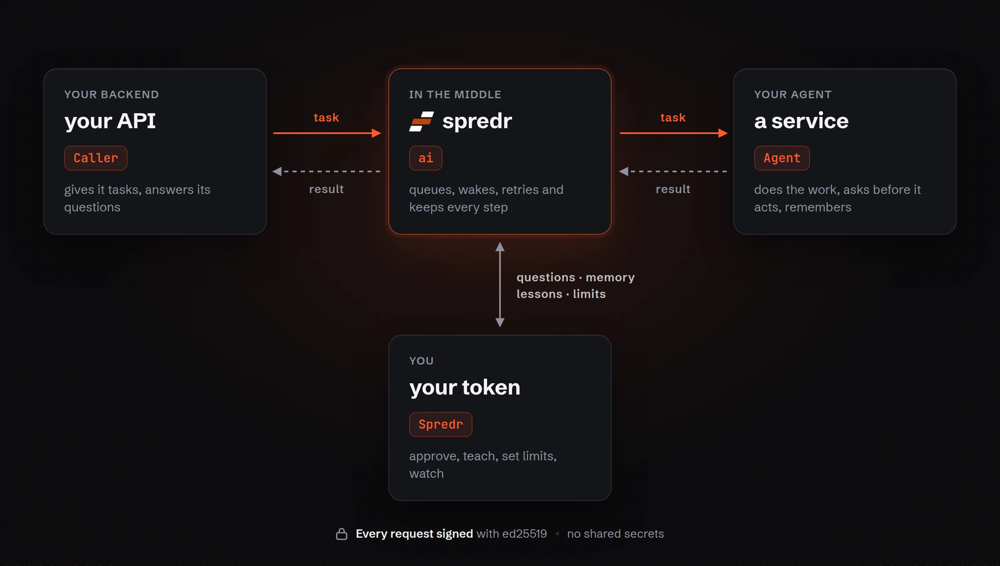

<p align="center">
  <a href="https://spredr.cloud"></a>
</p>

<h1 align="center">@spredr/sdk</h1>

<p align="center">
  <b>AI agents that run as your own services.</b><br>
  They take tasks, ask before they act, remember your customers, learn from your corrections, and sleep when idle.
</p>

<p align="center">
  <a href="https://www.npmjs.com/package/@spredr/sdk"></a>
  
  
</p>

<p align="center">
  <a href="#why-spredr-for-your-agents">Why</a> ·
  <a href="#quick-start">Quick start</a> ·
  <a href="#the-agent">The agent</a> ·
  <a href="#your-backend">Your backend</a> ·
  <a href="#one-agent-many-users-at-once">Many users</a> ·
  <a href="#you-with-your-token">Your token</a> ·
  <a href="#traces">Traces</a> ·
  <a href="https://spredr.cloud/pricing">Pricing</a>
</p>

---

## Why spredr for your agents

- **Nothing happens twice.** When a task comes back (after a question, or after a crash), every answer and every
  step it already took gives back what it gave: the model is not paid twice, a customer is not charged twice. No
  «write it to run twice» rule.
- **It asks before it acts.** A risky action waits for a person; approved often enough, it is offered to run alone,
  and an undo takes that back. `autoPerDay` and `spendPerDayUsd` keep a mistake small.
- **It remembers, and it learns.** Memory by customer (and forgetting one on request); your corrections become
  lessons, tried on past tasks before they go live.
- **One agent, thousands of users at once.** Each task says whom it works for (a person, an account, a team, a
  business), and spredr keeps each one apart: its turn in the line, its memory, what it lets the agent do alone, its
  own rules and its caps. One busy user never holds the others back; measured with 301 of them and 1,900 tasks at once.
- **Any model, your key.** Claude, OpenAI, Gemini or a model of your own, called by your code with your key: spredr
  never sits between your agent and its model. `ctx.model()` reads the tokens of Claude, OpenAI and the AI SDK.
- **Light.** An agent takes about 25 MB idle and 36 MB working, measured with a real Claude agent; an agent asleep
  uses no CPU, and spredr adds about 10 ms of its own CPU per task.
- **Yours to watch and to take.** Each task is a trace with its steps, tokens and cost, sent to your
  OpenTelemetry tools (Langfuse, Datadog, Honeycomb); every task exports as NDJSON.
- **Built to be trusted.** Every request signed, no shared secrets, no dependencies, typed end to end, and tested:
  61 tests over 99% of the code, plus the SDK against spredr's real agents service on every change there.

Agents run as your plan's services, with their tasks included: see [pricing](https://spredr.cloud/pricing).

## Three pieces, one agent

An agent on spredr is a normal service: your code, your repo, deployed like any backend. This package is how the
three parties around it talk to each other.

| You are | You use | You can |
|---|---|---|
| **The agent** | `Agent` | take tasks, ask a person before a risky action, remember, learn, report each step |
| **Your backend** | `Caller` | give the agent tasks, follow them, answer its questions, receive callbacks |
| **You** | `Spredr` | register agents, link backends, schedule work, read memory, approve lessons, set limits |

<p align="center">
  
</p>

**Requirements.** Node 22.12 or newer, and nothing else: the SDK has no dependencies. It is written in TypeScript and
ships its types.

**No shared secrets.** Every request is signed with ed25519, and each side keeps only the other's public key. When you
register an agent or link a backend, spredr writes the keys into that service's variables for you: there is nothing to
copy or paste.

## Quick start

**1. Install the CLI and sign in**

```sh
curl -fsSL https://spredr.cloud/install | sh
spredr login
```

**2. Write the agent**

```sh
npm install @spredr/sdk @anthropic-ai/sdk
```

```ts
// index.ts
import { Agent } from '@spredr/sdk';
import Anthropic from '@anthropic-ai/sdk';

const claude = new Anthropic(); // ANTHROPIC_API_KEY, set with: spredr vars set shop-agent ANTHROPIC_API_KEY=…

export const shop = new Agent({ description: 'Answers the shop\'s customers', sleepAfterMinutes: 15 })
  .on('reply', async ({ text }: { text: string }, ctx) => {
    const message = await ctx.model(() => claude.messages.create({   // timed, model and tokens reported for you
      model: 'claude-haiku-5-5',
      max_tokens: 400,
      system: ['You answer for a small shop. Be brief.', ...ctx.lessons].join('\n'),
      messages: [{ role: 'user', content: text }],
    }));
    const answer = message.content.find((block) => block.type === 'text');
    return { reply: answer?.type === 'text' ? answer.text : '' };
  });

shop.listen(); // PORT, 8080 by default
```

**3. Deploy it and make it an agent**

Push it to a repo, then:

```sh
spredr new you/shop-agent --port 8080   # a service, built from your repo
spredr agents add shop shop-agent       # the service becomes the agent «shop»
```

**4. Give it a task**

```sh
spredr ask shop reply '{"text":"Are you open on Sunday?"}'
```

**5. Call it from your backend**

```ts
import { Spredr } from '@spredr/sdk';

// once, with your token: link your backend's service to the agent
await new Spredr().agent('shop').addCaller('shop-api', { service: 'shop-api' });   // reads SPREDR_TOKEN
```

```ts
// in shop-api: the variables are already there
import { Caller } from '@spredr/sdk';

const { reply } = await new Caller().result('reply', { text: 'Are you open on Sunday?' });
```

That is the whole loop. Everything below is reference.

## The agent

```ts
import { Agent } from '@spredr/sdk';

new Agent({
  description: 'Answers the shop\'s customers',
  tasks: [{ kind: 'reply', description: 'Answer one message' }],
  actions: [{ name: 'refund', neverAuto: true }],
  sleepAfterMinutes: 15,
  concurrency: 4,
})
  .on('reply', async ({ customer, text, wantsRefund }: { customer: string; text: string; wantsRefund?: boolean }, ctx) => {
    const known = await ctx.memory.recall({ scope: `customer:${customer}` });
    if (wantsRefund) {
      const answer = await ctx.ask('refund', `Refund ${customer}?`);
      if (!answer.yes) return { reply: 'We cannot refund this one.' };
    }
    await ctx.memory.remember(`customer:${customer}`, `Asked: ${text}`, { key: 'last' });
    return { reply: await think(text, known, ctx.lessons) };   // think(): your model call
  })
  .listen();
```

Each task kind gets a handler. **What it returns is the task's result, and what it throws is its error.** To check
the input before the handler runs, give `on()` a schema: zod, valibot, arktype or any
[Standard Schema](https://standardschema.dev). A task whose input does not match fails, saying where.

```ts
import { z } from 'zod';

agent.on('reply', z.object({ text: z.string().min(1) }), async ({ text }, ctx) => ({ reply: text }));
```

The options, besides the manifest (`description`, `tasks`, `actions`, `tools`, `sleepAfterMinutes`, `concurrency`,
`timeoutSeconds`, `judge`) and the shared ones under [Errors and retries](#errors-and-retries):

| Option | Default | |
|---|---|---|
| `shutdownGraceMs` | 25 000 | on a stop, how long running tasks may finish |
| `log` | the console | where its lines go; `false` says nothing |
| `tagLogs` | `true` | what a task prints with `console` starts with its id; `false` leaves console alone |
| `id`, `key`, `ai`, `aiKey` | its variables | written by spredr when it registers the agent |

`ctx` gives the handler the rest:

| | |
|---|---|
| `ctx.ask(action, question)` | Asks a person first, and stops the task until someone answers. An action marked `neverAuto` asks every time. |
| `ctx.memory` | `remember(scope, text)`, `recall({ scope, q })`, `forget(id)`. A scope is whatever groups facts, such as `customer:ana`. `remember` gives back `null` when the fact was not kept (the agent's memory is full, or its tenant's share): the task goes on, and why is in its logs. |
| `ctx.lessons` | The lessons you approved. Put them in your prompt. |
| `ctx.trial` | `true` when an old task is replayed to test new lessons: **do nothing real**, just answer. |
| `ctx.model(() => call)` | A model call, timed and reported with its model and tokens, read from the answer of Claude, OpenAI or the AI SDK. |
| `ctx.track(kind, name, work, usage?)` | Times any other step (`tool`, `memory`, `other`) and reports it: a charge, an email, a call to your API. Steps are the task's trace, its cost and its timeline. |
| `ctx.later(kind, input, at)` | A task for later: a reminder, a follow-up, for the same tenant and thread. |
| `ctx.tenant`, `ctx.thread` | Whom this task works for (a user, an account, a team, a business; `""` when no one in particular) and its conversation. |
| `ctx.progress(data)` | Tells the caller how it is going, and keeps a long task alive. |

**Nothing happens twice.** When a task comes back (after a question, or given again after a crash), its handler runs
from the top, but everything it already did through `ctx` gives back what it gave the first time instead of happening
again: each answered question, each `ctx.model`, `ctx.track`, `ctx.memory.remember` and `ctx.later`. The model is not
paid twice and a customer is not charged twice. So put side effects in `ctx.track`; only code outside `ctx` runs again.
If the handler takes another way than before (another question, another step), it runs for real from there on. What a
step gives back comes back as JSON (a `Date` comes back as its text), up to 256 KB; a bigger one simply runs again.

**Learning.** The agent reads the verdicts on its tasks with `agent.feedback()` and turns what it sees into a lesson
with `agent.propose(text, why)`. A lesson goes live only when you approve it, and before that it can be tried on old
tasks (`ctx.trial`).

**Sleeping.** An agent that is quiet for `sleepAfterMinutes` is put to sleep and uses no CPU. The next task wakes it, and waits until
it answers.

**Stopping.** On a deploy or a stop, the agent takes no new task and lets the running ones finish, up to
`shutdownGraceMs` (25 s); `/health` answers 503 meanwhile. A task still running then is given again by spredr. To stop
it yourself, `await agent.close()`.

**Inside your own server.** An agent can live in a server you already run (Fastify, Express, Hono) instead of
`listen()`: route its path to `handle()` with the raw body, since the signature is over those bytes, and send back what
it returns. `start()` says hello; your server's shutdown calls `close()`.

```ts
app.post(shop.path, async (request, reply) => {   // with the body kept raw for this route
  const answer = await shop.handle({ method: 'POST', path: request.url, headers: request.headers, body: request.rawBody });
  return reply.code(answer.status).headers(answer.headers).send(answer.body);
});
await shop.start();
```

### Its logs, task by task

What a task prints with `console` starts with its id, however deep in your code (`[tsk_7f3a…] looking up the
catalog`), and the agent writes one line when each task ends (`tsk_7f3a… reply done in 4.6 s`, or why it failed). So
searching the deployment's logs for a task's id, as the panel's «Ver sus registros» does, finds what it did. A logger
that writes on its own adds the id with `currentTask()`:

```ts
import pino from 'pino';
import { currentTask } from '@spredr/sdk';

const log = pino({ mixin: () => ({ task: currentTask() ?? undefined }) });   // {"task":"tsk_7f3a…","msg":"…"}
```

## Your backend

```ts
import { Caller } from '@spredr/sdk';

const agent = new Caller();   // reads the variables spredr wrote into this service

const task = await agent.run('reply', { customer: 'ana', text: 'hola' }, { key: messageId, thread: 'customer:ana' });

if (task.status === 'paused') {
  const [question] = await agent.pauses();         // show it in your app
  await agent.answer(question.id, { yes: true });
}

await agent.feedback(task.id, 'bad', { correction: 'Offer two times.' });   // kept for the agent to learn from
```

| | |
|---|---|
| `result(kind, input)` | Asks, waits, and gives back the result. A task that fails, is canceled or waits for an answer throws a `TaskError` carrying it. |
| `run(kind, input)` | Asks and waits for the outcome, whatever it is. |
| `ask(kind, input)` | Asks and returns at once. `settle(id)` waits for it later. |
| `key` | Your own id for the task: asking twice with the same key is the same task, never two. |
| `thread` | Tasks with the same thread read as one conversation. |
| `at` | When to start. |
| `list()`, `events(id)`, `steps(id)`, `cancel(id)` | Follow and stop tasks. |
| `pauses()`, `answer(id, answer)` | The questions the agent is waiting on. |
| `feedback(id, 'good' \| 'bad', { correction })` | Your verdict, with what it should have done. |

**Types, end to end.** Give the backend your agent's type and TypeScript checks each kind's name, input and result:

```ts
import type { shop } from '../shop-agent/index.ts';
import { Caller, type KindsOf } from '@spredr/sdk';

const agent = new Caller<KindsOf<typeof shop>>();
const { reply } = await agent.result('reply', { text: 'hola' });   // reply: string
```

**Callbacks.** Link the backend with a `callbackUrl` and spredr POSTs `task.done`, `task.failed`, `task.paused` and
`task.canceled` to it. Believe one only when `agent.callback({ method, path, headers, body })` returns it, and give it
the raw body. With `everything: true` the backend receives every task's events, not only its own.

## One agent, many users at once

Most agents serve many people at once: an assistant with thousands of users, a support agent for many accounts, a
booking agent for many businesses. Each task can say whom it works for, its **tenant**: whatever your app calls one of
them (a user id, an account, a team, a business). Open a session for one with `for(tenant)`:

```ts
const user = agent.for('user_42');   // agent is your Caller

const { reply } = await user.result('reply', { text: 'remind me to call mom on Friday' }, { thread: 'chat_9' });
```

spredr keeps each tenant apart, with nothing for your agent to remember:

| | |
|---|---|
| **Its turn** | The line goes in turns between tenants: one with a thousand tasks waiting never holds the others back. |
| **Its memory** | `ctx.memory` in a task reaches that tenant's facts alone, whatever the model is talked into. All tenants share the agent's room; `setLimits({ facts })` caps one's share. |
| **Its freedom** | `user.setFreedom('send_email', 'auto')` lets the agent act alone for this tenant, never for another. |
| **Its rules** | `user.teach('Call me Ana, never by my surname')` reaches this tenant's tasks from that moment on, and no other's. |
| **Its caps** | `user.setLimits({ spendPerDayUsd: 0.5, autoPerDay: 20 })`: past them it waits for tomorrow, and the rest go on. |
| **Its questions** | `user.pauses()`, and every `task.paused` callback names the tenant, so it reaches the right person. |
| **What it used** | `user.usage()`: tasks, cost and tokens, today and this month, to bill or limit each one for what it used. |
| **Forgetting it** | `user.forget()` erases its tasks, memory, questions, freedom, rules and caps. The others stay. |

In the agent, `ctx.tenant` says whom the task works for. With your token, `spredr.agent('assistant').tenants()` lists
them with what each used, and `setTenantLimits()` caps every tenant without caps of its own. A task with no tenant is
the agent's own work, as before.

## You, with your token

```ts
import { Spredr } from '@spredr/sdk';

const spredr = new Spredr();   // SPREDR_TOKEN, or new Spredr({ token })
const shop = spredr.agent('shop');

await spredr.register('shop', 'shop-agent');                    // a service becomes an agent
await shop.addCaller('shop-api', { service: 'shop-api' });     // a backend may call it
await shop.schedule('morning', 'digest', '0 8 * * *', { tz: 'America/Bogota' });
await shop.hook('orders', 'new-order');                        // a webhook URL that makes tasks
await shop.setFreedom('refund', 'ask');                        // ask before refunds
await shop.setLimits({ autoPerDay: 200, spendPerDayUsd: 15 });

await shop.summary();          // its last day: tasks, failures, times, tokens, cost
await shop.memory({ scope: 'customer:ana' });
await shop.forget('customer:ana');                              // a customer who asks to be forgotten
await shop.lessons();          // proposed and live lessons; decide(id, 'accept') to approve one
await shop.export();           // every task with its steps
await spredr.inbox();          // what waits for you, across every agent
```

**Limits keep a mistake small.** `autoPerDay` caps the actions it takes alone in a day; past it, it asks again.
`spendPerDayUsd` caps what its model calls cost in a day, read from the steps it reports; past it, new tasks are
refused until tomorrow.

## Traces

Every finished task can go to your OpenTelemetry endpoint as a trace: the task as the root span, each step as a child
with the GenAI attributes (`gen_ai.*`) that Langfuse, Datadog, Honeycomb and Grafana read.

```ts
import { Spredr } from '@spredr/sdk';

await new Spredr().agent('shop').setTraces({
  endpoint: 'https://cloud.langfuse.com/api/public/otel/v1/traces',
  headers: { authorization: `Basic ${btoa(`${publicKey}:${secretKey}`)}` },
});
```

The headers are sealed by spredr and never shown back. The task's input and result travel only with
`withContent: true`.

## Errors and retries

Every error is a `SpredrError`, with ai's own words, its `status` and its `trace`. Catch the base, or the case you
handle: `BadRequestError` (400), `AuthenticationError` (401), `PermissionDeniedError` (403), `NotFoundError` (404),
`ConflictError` (409), `RateLimitError` (429, with `retryAfter`), `InternalServerError` (5xx), `ConnectionError` and
`TimeoutError` (no answer). A task that ends badly is a `TaskError`.

A request is tried again only when that is safe: no answer came or spredr failed, on a call that does the same thing
twice (reads, updates, deletes, and a task asked with its own `key`). A 429 is tried again only when spredr says how
long to wait, so a cap reached comes straight back to you. Each side takes the same options:

| Option | Default | |
|---|---|---|
| `timeoutMs` | 75 000 | how long one request may take |
| `maxRetries` | 2 | how many more tries, when safe; 0 never |
| `retryDelayMs` | 500 | the first wait, doubling up to 8 s |
| `fetch` | the global one | a fetch of your own |

## Variables

spredr writes these into your services when you register an agent or link a backend. You only set `SPREDR_TOKEN`.

| Variable | Read by | What it is |
|---|---|---|
| `SPREDR_AGENT_ID`, `SPREDR_AGENT_KEY` | `Agent` | the agent's id and private key |
| `SPREDR_CALLER_ID`, `SPREDR_CALLER_KEY`, `SPREDR_AGENT` | `new Caller()` | the backend's id, its private key, the agent it calls |
| `SPREDR_AI_URL`, `SPREDR_AI_KEY` | `Agent`, `Caller` | where spredr's agents live, and its public key |
| `SPREDR_TOKEN` | `Spredr` | an API token of yours, made in the panel (Account › API tokens) |
| `PORT` | `Agent.listen()` | the port it listens on, 8080 by default |

## Plans

An agent runs as one of your plan's services, so Starter runs up to 3 and Pro up to 10. The plan also sets the tasks a
month, how much each agent remembers and how long finished tasks are kept. Exporting and traces are always included.
See [spredr.cloud/pricing](https://spredr.cloud/pricing).

## Without the SDK

It is plain HTTP and works from any language: signed requests one way, signed callbacks the other. The SDK has no
dependencies; write to us if you need the protocol for another language.

---

<p align="center">
  <a href="https://spredr.cloud"></a><br>
  <sub><a href="https://spredr.cloud">spredr.cloud</a> · © 2026 Candhrly, LLC · <a href="LICENSE">license</a></sub><br>
  <sub>Free to use with spredr. spredr and its logo are trademarks of Candhrly, LLC.</sub>
</p>
